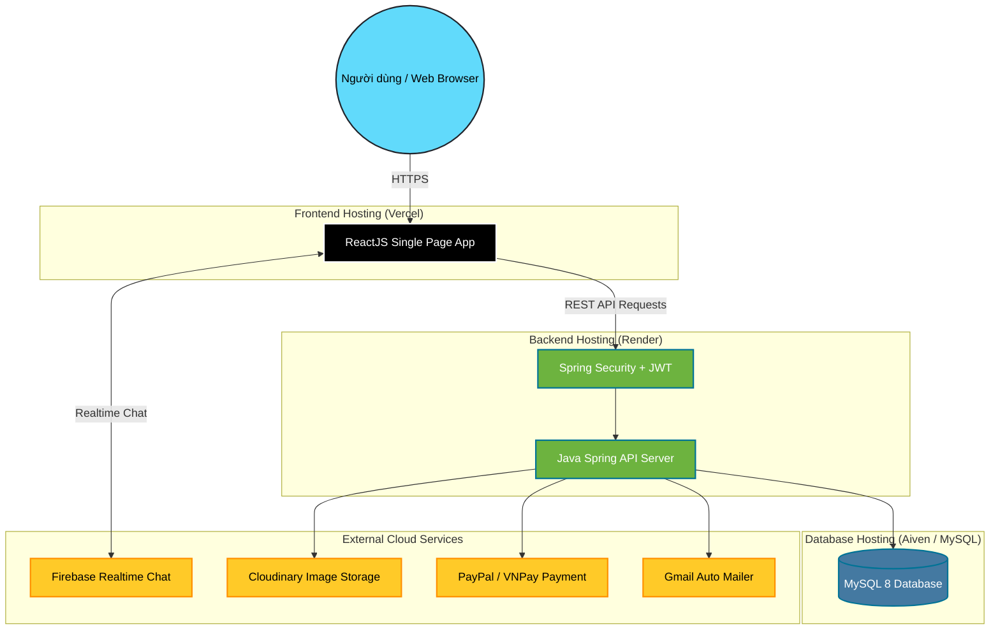

<div align="center">
  
  
  <h1 align="center" style="font-weight: 300; letter-spacing: 2px;">HỆ THỐNG QUẢN LÝ XE KHÁCH CAO CẤP (FULLSTACK)</h1>
  <p align="center" style="font-size: 1.1em; color: #666; font-style: italic;">
    — Ứng dụng Web Quản Lý & Đặt Vé Xe Khách Đa Nền Tảng —
  </p>

  <p align="center" style="margin-top: 20px;">
    
    
    
    
    
  </p>

  <p align="center">
    🚀 <b>Live Demo (Frontend Web):</b> <a href="https://quan-li-xe-khach.vercel.app" target="_blank">https://quan-li-xe-khach.vercel.app</a><br/>
    ⚙️ <b>Backend API Server:</b> <a href="https://doannganhquanlixekhach.onrender.com/" target="_blank">https://doannganhquanlixekhach.onrender.com</a>
  </p>
</div>

<br/>

## 1. TỔNG QUAN DỰ ÁN
Hệ thống **Quản Lý Bến Xe Khách** là giải pháp toàn diện hỗ trợ đặt vé trực tuyến, quản lý chuyến xe, quản lý tài xế, trạm xe, thanh toán trực tuyến và tương tác hỗ trợ khách hàng realtime. 

Dự án được thiết kế theo kiến trúc **Fullstack Decoupled (Tách biệt Frontend & Backend)**:
- **Frontend Web:** Xây dựng bằng ReactJS, giao diện hiện đại, tích hợp Trợ lý AI và Chat Realtime Firebase.
- **Backend API Server:** Xây dựng bằng Java Spring MVC / Spring Security, xử lý logic nghiệp vụ, bảo mật JWT, thanh toán PayPal/VNPay và tự động gửi vé điện tử qua Email.

---

## 2. CHI TIẾT CÁC TÍNH NĂNG CỐT LÕI (FEATURES)

### 💻 Phân hệ Frontend (ReactJS Web App)
- **Đặt vé & Chọn ghế trực quan:** Chọn chuyến xe, sơ đồ ghế ngồi realtime, áp dụng mã giảm giá (Voucher).
- **Vé của tôi & Mã QR:** Quản lý lịch sử đặt vé, tự động tạo **Mã QR Code** cho từng vé để quét soát vé nhanh.
- **Admin Dashboard & Thống kê:** Báo cáo biểu đồ doanh thu, thống kê chuyến xe, quản lý xe, tài xế, tuyến đường.
- **Hỗ trợ Chat Realtime & Trợ lý AI:** Tích hợp Firebase Realtime Database cho phép khách hàng/tài xế/nhân viên nhắn tin trực tiếp với quản lý & Trợ lý AI giải đáp thắc mắc tự động.
- **Đa giao diện (Responsive Design):** Tương thích mượt mà trên cả Desktop, Tablet và Mobile.

### 🛡️ Phân hệ Backend (Java Spring API)
- **Định danh & Phân quyền (Auth & Security):** 
  - Token-based Authentication (**Stateless JWT** với `Nimbus JOSE JWT`).
  - Phân quyền 5 cấp độ (**ADMIN, MANAGER, STAFF, DRIVER, PASSENGER**).
- **Cổng thanh toán trực tuyến (Payment Gateways):**
  - **PayPal SDK:** Thanh toán quốc tế trực tuyến.
  - **VNPay API:** Mã hóa chữ ký điện tử `HmacSHA512` bảo mật giao dịch nội địa.
- **Tự động gửi Mail (Auto-Mailer):** Gửi **Vé Điện Tử (HTML Template)** bất đồng bộ qua Gmail SMTP ngay khi thanh toán thành công.
- **Lưu trữ Cloudinary CDN:** API upload và quản lý ảnh đại diện, ảnh xe trên đám mây.

---

## 3. KIẾN TRÚC HỆ THỐNG (SYSTEM ARCHITECTURE)



---

## 4. CẤU TRÚC THƯ MỤC NGUỒN (PROJECT STRUCTURE)

```
DoAnNganhQuanLiXeKhach/
├── CarManagementWeb/
│   └── carmanagementweb/       # Mã nguồn Frontend ReactJS (Vercel Root)
│       ├── public/
│       └── src/
│           ├── components/     # AdminDashboard, MyTickets, SeatBooking, Chat...
│           ├── configs/        # Apis.js, Firebase.js...
│           ├── contexts/       # ChatContext.js, Contexts.js...
│           └── services/       # ChatService.js, NotificationHandler.js...
├── src/                        # Mã nguồn Backend Java Spring (Render Root)
│   └── main/
│       ├── java/com/dnl/       # Controllers, Services, Repositories, Configs...
│       └── resources/          # application.properties, HibernateConfigs...
├── pom.xml                     # Maven Build Configuration cho Spring Backend
├── vercel.json                 # Vercel Deployment Configuration cho React Frontend
└── Dockerfile                  # Docker Deployment Configuration cho Backend
```

---

## 5. HƯỚNG DẪN TRIỂN KHAI CHẠY LOCAL (LOCAL SETUP)

### Yêu cầu hệ thống
- **Node.js 18+ & npm**
- **Java 17 (JDK)**
- **Apache Maven 3.8+**
- **MySQL 8.0+**

### 1️⃣ Khởi chạy Frontend (ReactJS)
```bash
cd CarManagementWeb/carmanagementweb
npm install
npm start
```
Ứng dụng Web sẽ chạy tại: `http://localhost:3000`

### 2️⃣ Khởi chạy Backend (Java Spring)
Cấu hình DB trong `src/main/resources/HibernateConfigs.java` hoặc `application.properties`:
```properties
jdbc.url=jdbc:mysql://localhost:3306/carmanagementdb
jdbc.username=root
jdbc.password=your_password
```
Build và chạy bằng Maven / Tomcat Server:
```bash
mvn clean install
```
Server Backend sẽ chạy tại: `http://localhost:8080`

---

<br/>
<div align="center">
  <hr style="width: 50%; border: 1px solid #eaeaea;" />
  <p style="color: #888; font-size: 0.9em; margin-top: 20px;">
    <i>Hệ Thống Quản Lý Bến Xe Khách — Kiến trúc hiện đại, vận hành bền vững.</i>
  </p>
</div>
